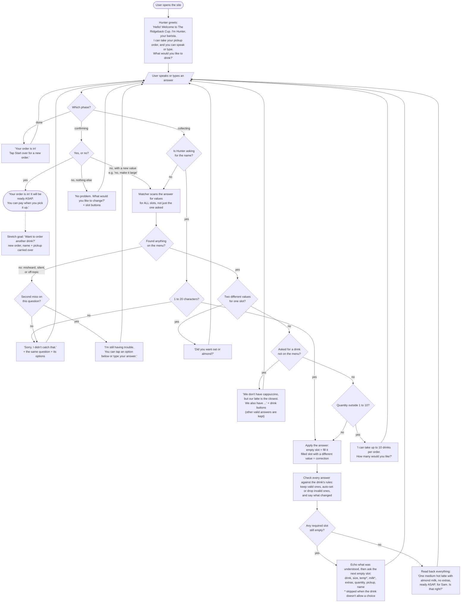
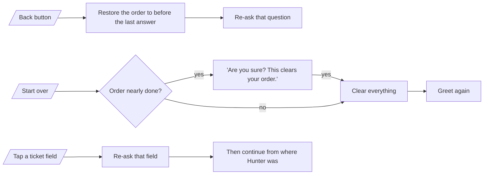

# Conversation Flowchart — Hunter (The Ridgeback Cup)

How Hunter handles every user input, from the greeting to the confirmed order.
GitHub renders the diagram below automatically. Role 3 can redraw it in Figma for the slides and report.

## Main flow: every typed or spoken answer

## Control buttons (UI events, not speech)

Repeat and Mute are handled entirely by the UI (they replay or silence the last reply) and never reach the engine.

## Drink rules used by "Check every answer against the drink's rules"

| Drink | Temperature question | Milk question |
|---|---|---|
| Coffee | Hot or iced | Oat, almond, whole, or no milk |
| Ridgeback Roast | Hot or iced | Oat, almond, whole, or no milk |
| Latte | Hot or iced | Oat, almond, whole (required) |
| Matcha latte | Hot or iced | Oat, almond, whole (required) |
| Hot chocolate | Skipped (always hot) | Skipped (no milk choice) |

Example: "a large iced cappuccino with oat milk", then the user picks hot chocolate.
Large is kept; iced is changed to hot and oat milk is dropped, and Hunter says so; the next question is extras.

## How the 6 required test cases map to this chart

| Test case | Where it happens |
|---|---|
| Normal completion | Ask next empty slot → Read back everything → yes → order placed |
| Missing information | "a latte" fills one slot → Ask next empty slot repeats until all are filled |
| Invalid answer | Asked for a drink not on the menu → closest match + drink buttons |
| Correction | Apply the answer: filled slot with a different value = correction; also "no, make it large" at confirm |
| Voice recognition problem | Found nothing → re-ask with options → after the second miss, suggest tapping or typing |
| Final confirmation | Read back everything → Yes, or no? |
